# Recipes

A recipe is a whole screen in one file under `recipes/`, with sample data at
the top and one default export. Copy the file, keep its structure, replace
the data. The pictures in `images/` are drawn from these files by
`packages/ui/scripts/v2-preview.ts` (light, 1440 and 390 px), and a browser
test keeps every recipe free of findings, so code and picture always match.

Read the recipe file next to its picture: each part in the code is one
thing you can point at in the image.

Every recipe shows a real screen in the look of the skill ("The look"):
a sidebar with the app's places, each thing with its mark or avatar,
states as colour and word, people beside what they did, ten rows and
more of dense German sample data. The export `app` (`{ color, icon }`)
names the app the screen belongs to; the pictures, Fibel and the tests
draw every recipe in the frame of its host (a tinted page with a rail of
apps, the app marked in it). A browser test fails a recipe whose rows,
table rows or tiles show a thing without its `Mark` or `Avatar`.

Most recipes also export `states`: the same screen empty, loading, failed
or in another state that fits it (a form while it saves). Fibel's examples
switch between them, and the browser test checks each one. A state stands
where the data would stand; the head and the status row never move. A
state that shows an open menu, panel, dialog or toast is `{ render, press }`:
the screen, and the names of the buttons and menu entries a person presses,
in order, to open it.

## frame.tsx: the frame of an app

`Workspace` with `detail` and `detailEmpty`; a `Nav` with two groups
(a group `action`, a `dot`, a folding "Mehr", a `foot`); a head `Bar`
with `Tabs` (a menu tab "Weitere") and the one primary, mirrored as
`Workspace primary`; a list `Pane` with `width`, `scrollKey` and a
`StatusRow`; the open entry as `Pane detail` with `back`, a head `Bar`
with the thing's `Mark` before its name, a status `Bar` with `Inline`
chips, `Cells` with its figures, `Facts` with the person in charge as an
avatar, its parts as rows with marks and state chips, and its history as
`Digest activity`. Every order leads with the mark of its machine; only a
state that is not "in plan" speaks up as a chip in `marks`.

- What is open comes from the address. Without an open entry the detail is
  not rendered (`undefined`, never `false`), and `detailEmpty` holds its
  place, so nothing moves when it opens.
- On a tablet the sidebar becomes a drawer behind a button in the head; on
  the phone the open entry is the page and `back` is its one way back.
- States: `closed`, `empty`, `loading`, `failed`.

## tree.tsx: folders as a tree

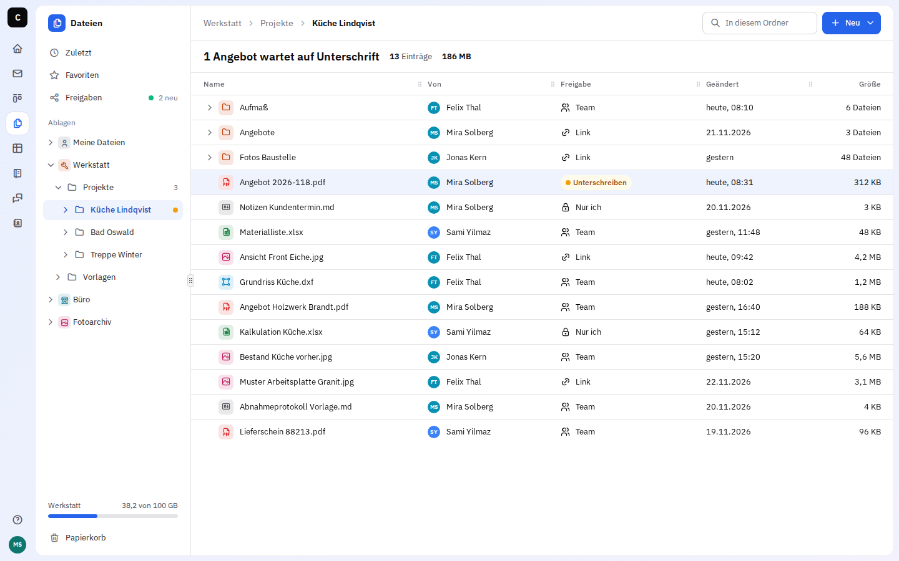

`Nav` with a plain group ("Zuletzt", "Favoriten") and a group with `tree`
(folders; "Website" is `current`, so the way to it is open; "Archiv" and
"Texte" are `branch` and load on the first open; "Kunden" has `more`); a
head `Bar` with the `Path` and the one primary; a `Pane` with a
`StatusRow` and a `Table` with `tree` (folders and files as rows in
levels; the open file is `current`, so its folder starts open).

- Give the loaded nodes down to the open place; the rest loads through
  `load` and `loadMore` when a person opens it. Never load the whole tree.
- On the phone the sidebar is a drawer with the same tree, and the table
  shows its top level; a folder opens as its own page.

## list-detail.tsx: a list beside the open entry

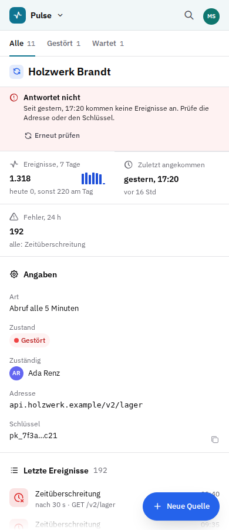

`Workspace` with `Nav`, a head `Bar` with `Tabs` and the main action;
`Pane.Split` with the list (`StatusRow` with what counts today and a
toned chip, `List` of two-line `Row`s with the mark of their kind, a state
chip only where something is wrong, the open one `current`) and a
`Pane detail` (head `Bar` with mark, name and actions, `Notice tone="bad"`
with a way out, `Cells` with a `trend`, `Facts` with the person in
charge, the latest events as rows with marks, and who changed it as
`Digest activity`).

- On the phone the detail pane leaves. Open an entry as its own route there.
- An error of the open entry is a `Notice` at the top of the detail, not a
  red text somewhere.

## form.tsx: a form with server errors and a conflict

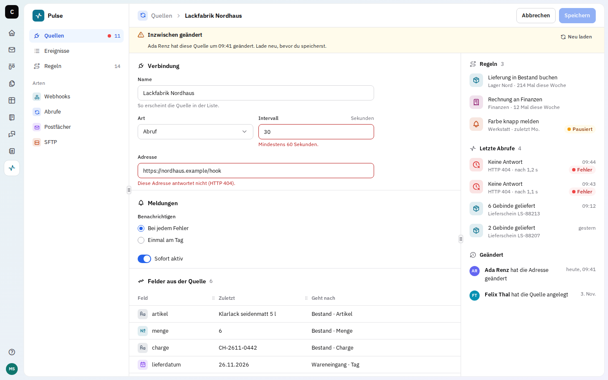

A `Path` with the thing's mark in the head and "Abbrechen" with the one
primary "Speichern" at its end (mirrored as `Workspace primary`), disabled
while the conflict lasts; `Notice tone="warn"` for a conflict that blocks
saving; `Section`s of `Field`s (`Field.Row` for fields side by side); a
server error goes into the `error` of its field; `Choice` and `Check
switch` for options; a `Pane side` with what the thing feeds (rows with
marks and a state chip) and who changed it (`Digest activity`).

- Validation and server answers live in the app's state; the primitives
  only show `error`.
- Settings are not a form: they stand as rows of label and hint with the
  value at a fixed width beside them (rule 10 of "The look").
- A long form stands in its own pane or route; a short task above the page
  is a `Dialog` (see `dialogs.tsx`).
- States: `fresh` (nothing sent yet), `errors` ("Pflichtfeld." and the
  server's errors at their fields), `saving` (`Button busy`).

## form-detail.tsx: a form beside a list

The page's one primary "Neuer Termin" stays in the head; the list shows
each appointment with the mark of its kind and the fitter in its second
line, and a clash as a chip; the form is a `Pane detail` beside the list, so the list stays in view while it is
filled in, with `Select`, `DateInput`, `Input`, `Choice` inside a `Field`, a
multiline `Input`, and `Check`s, one of them `disabled` with the reason
in its words. Its footer `Bar` saves with a default button.

- A form beside a page with a head primary never gets a second primary.
- On the phone the form is the page; `back` leads to the list.
- States: `errors`, `saving`.

## pairing.tsx: pairing a device

A `Section` with `id` (a link target) holds the steps as `Text`, a
`QrCode` (the app makes its SVG with `@k2b/stdlib/qr`) and the code to
compare as `CodeDisplay`; the wait for the other device is a
`Notice tone="warn"`, which assistive technology hears politely.
"Gerät entfernen" asks with `Dialog.confirm({ …, danger: true })`.

- Steps of a pairing in a dialog: `Dialog stepwise`, so a shorter step
  does not make it jump.
- States: `paired`.

## settings.tsx: settings with more than text

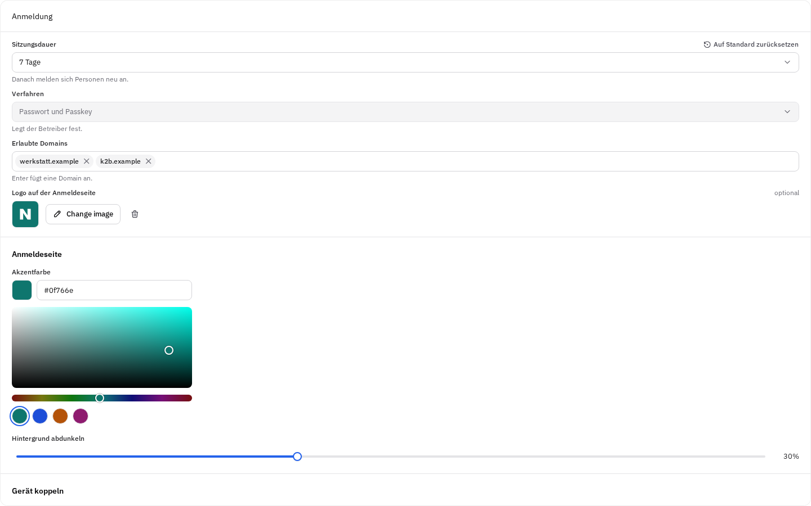

The sign-in settings of an app: a `Field` with an `action` that resets it
to its default, a `Select` the operator fixed (`disabled`), allowed
domains in a `TagsInput`, a logo in an `ImageInput`, an accent colour in a
`ColorInput`, how dark the background is in a `Slider`, a pairing code in a
`CodeInput`, and two `Disclosure`s with questions in a `Section`.

- A field's deed stands at the end of its label line and never moves the
  field; it takes the place of `optional`.
- A choice the person may not change is a dimmed control with the reason
  in its hint, not a missing one.
- States: `empty`, `locked`.

## record.tsx: a record, first tab

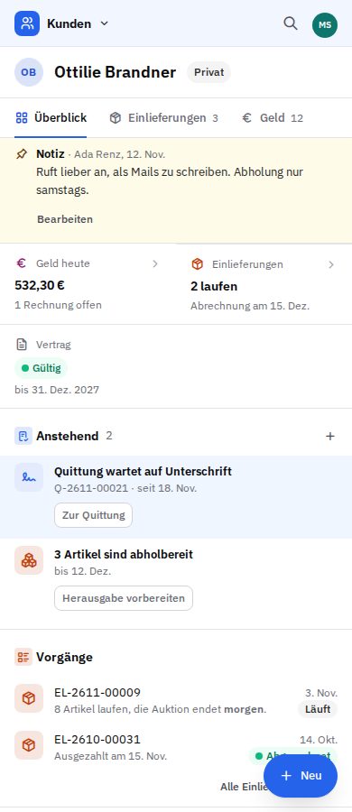

`RecordHead` in the head `Bar`; `Tabs` as the head of the record's `Pane`.
Across both columns: a pinned `Notice tone="note"` and `Cells` with the key
statements. Below them a `Pane.Split`: the main column with
`Section "Anstehend"` (`Row yours` with marks, row actions), a `Section`
with a `Digest` and a `more` link, and the customer's articles as rows
with the mark of their category, price and state; a `Pane side` with the
contact `Facts`, the people who look after the customer as rows with
avatars, and `Digest activity`.

- What needs a person comes first; history comes after.
- Area colours (`color`) mark the same area in cells, sections and groups
  (tabs carry no colour).
- States: `empty` (a new customer), `loading` and `failed` (the history,
  which loads on its own: its state stands in its section).

## record-groups.tsx: a record tab with groups

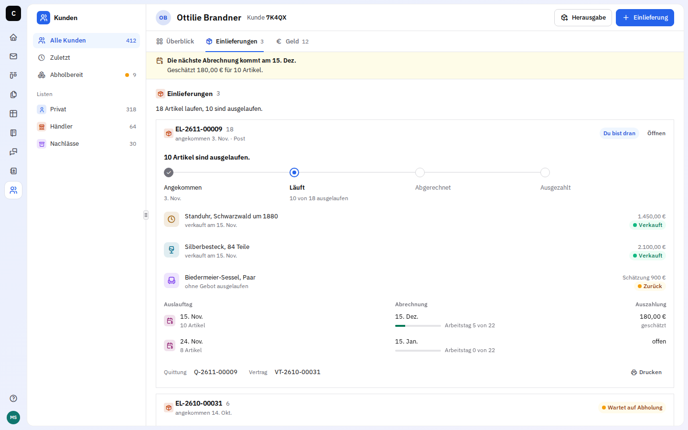

A `Band tone="note"` with the one statement of the tab; one `Section` for
the area with a `summary`; one `Group` per delivery with
`meta`, a `state` chip and actions. Inside a group: a strong sentence, its
way as `Steps`, its articles as rows with their marks and a state chip, a
`Table` with two-line cells and `Progress`, `Facts inline` with a print
button. A finished group is `folded`. The sidebar holds the app's places
and lists with their marks.

- Never a `Group` inside a `Group`, never a line inside one.
- "You are next" is `Chip yours`, not a red badge.
- States: `empty`, `loading`, `failed`, in the place of the groups.

## mail.tsx: a list with a reader

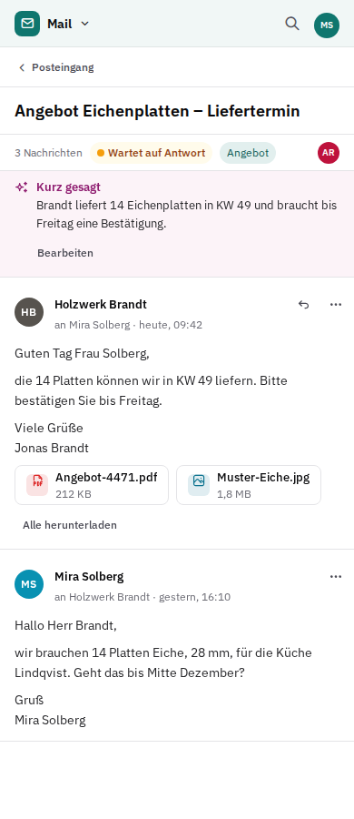

Three-line `Row`s (sender, subject, preview) with the sender's `avatar`,
`unread`, `meta` count, `time` and `marks`; mailboxes and shared mailboxes
in the `Nav` with their colours; `StatusRow` with select-all. The reader: head `Bar`
with the subject as `Text type="lead"` and actions; a `Bar` with `Inline`
chips; `Notice tone="ai"` for the summary; one `Band` per message with a
sender `Row` (avatar, icon buttons in `end`), `Prose`, `Tiles` with the
colour of each file type.

- A colleague's internal note in the thread is a `Notice tone="note"` with
  `title` and `meta` (who, when).
- The reply: until the composer of `@k2b/editor` arrives (gap), a `Band`
  with a `Field` and `<Input multiline />`, followed by a `Bar` whose `end`
  holds "Senden" as a default button (the page's primary stays "Neue
  Nachricht").

## overview.tsx: an overview of things with a face

The bases of Grids. `Nav` entries with `color`, so each base leads with its
`Mark`; a `StatusRow` whose lead says what counts today, with chips for
what lets a person act; `Tiles variant="card"` with `stats`, `people`,
`foot`, `trend` and the `create` card with templates as `choices`; a
`List` of two-line `Row`s with `mark` in the colour of their kind; a
`Pane side` with `Digest activity`, each sentence with the thing's
`Mark` and name.

- A base has one colour and symbol, the same in the sidebar, on its card
  and in a sentence. A kind of thing (table, board, form) has one colour
  across the app.
- A form or a workflow that did something is a person with its name.
- States: `empty` (a new installation; the card that makes a base stays).

## home.tsx: the home of one place

One base: `Cells` with a `trend` on the first, the things as `Section`s of
`Row`s with `mark`, their figures in the second line and their state as a
chip in `marks`; then `Digest activity` under "Zuletzt geändert".

- A state that needs a person (a failed workflow, new form entries) stands
  in its row and as a `dot` on its sidebar entry.
- States: `quiet` (a day without anything that needs a person).

## files.tsx: a folder with list, grid and selection

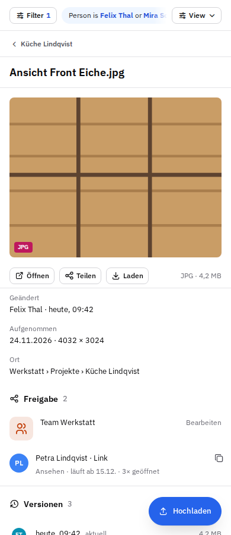

Two full-width rows above list and detail: a head `Bar` with `Path`, a
sharing `Chip`, the search, "Neuer Ordner" and the primary "Hochladen";
then the `FilterBar` with `results` and `end` (`ListOrder`, a `Menu` for
list or grid). The list is a `Table` with `select`, `group` (folders,
files), a `mark` column with thumbnails and types, an `avatar` column; the
open file is a `Pane detail` with `Preview`, a bar of deeds, `Facts` and
sections for sharing and versions. `Nav` shows storages with `color` and
the storage's `quota`.

- While files are selected, `StatusRow selection` takes the bar's place at
  the same height; on the phone its actions float at the bottom.
- States: `grid` (`Tiles variant="media"`), `selecting` (three photos).

## settings-page.tsx: a settings page

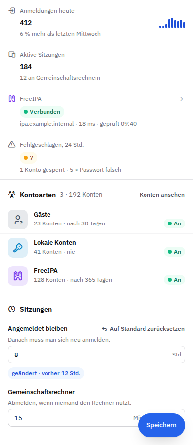

The state first as `Cells` (a `trend`, chips with tone); a `Table` for the
one setting with a value per kind (a switch per row); `Setting` rows for
everything else, one `Section` per topic; a `Pane side` with the methods
as rows with `mark` and state, and `Digest activity` of who changed what.
The head says "1 Änderung" and saves the page as a whole.

- States: `saved` (nothing to save: the deeds are disabled).

## table.tsx: a table with a status row

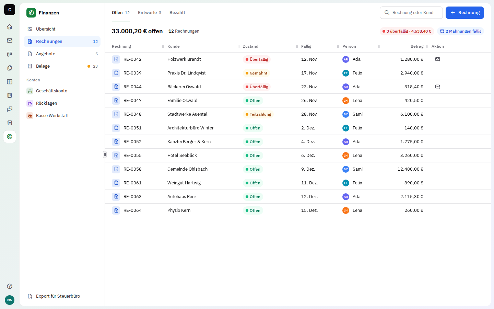
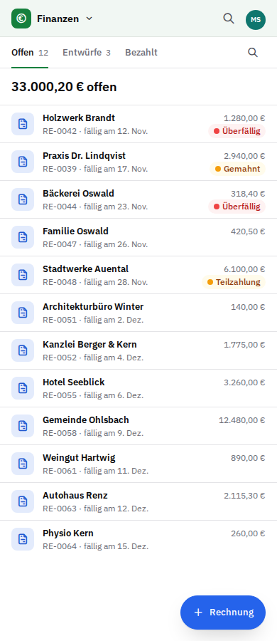

A `Nav` with the app's places and accounts; `StatusRow` with the lead
("33.000,20 € offen"), a count as fact and toned chips at the end (overdue,
reminders due); `Table` with widths, the invoice's `Mark` before its
number (in `Inline`), the person in charge as `Avatar`,
a status `Chip`, an amount column `align: "end"`, a quiet icon button with
its name only where the deed is due, `drop` on the columns that matter
least, and `phone(row)` so the phone shows two-line rows instead of a cut
table. `open(row)` gives each row the address of its invoice (on the phone
too); `empty` says "Keine offenen Rechnungen." in place of the table, and
`loading` would hold its place while the rows load.

- The lead says the one thing; the rest are facts, which leave on the phone.
- On the phone the rows keep the mark, and a state that needs a person
  stays as a chip in `marks`.
- A deed per row is a `Button` in its own last column: `variant="text"`
  with words where the table has room, a `ghost` icon with its `label`
  where the widths must fit beside a sidebar at 1024 px.

## filtered-table.tsx: a table people filter, sort and group

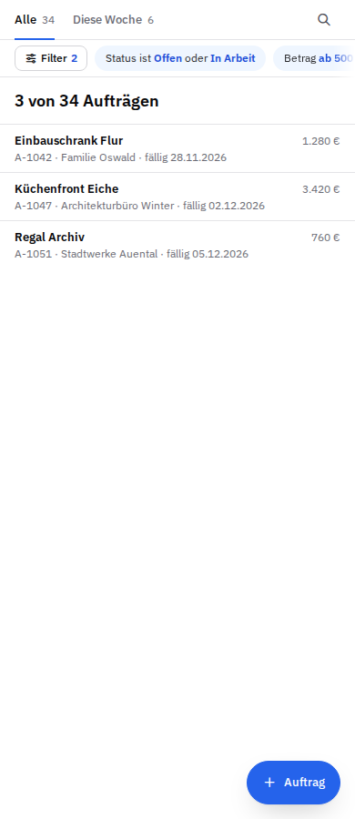

`defineListQuery` declares the fields (`choice`, `numberRange`, `lookup`),
the search, the sorts and the grouping once; `FilterBar` shows the active
filters as statements in `Pane status` above the `StatusRow`, and
`ListOrder` shows the sort and the grouping in its `filters`. The `Table`
shows what the server found for the address: each order with the mark of
its kind, the team as `Avatar` or `Avatar.Stack`, the state as a chip.

- The server reads the same address with `orderQuery.parse(...)` and filters
  its own data; `@k2b/ui` filters nothing.
- The bar writes the address and calls `onChange`; load the rows again there.
- On the phone the bar is one line that scrolls; a tap opens the filter sheet.
- Pass `views` only when the app stores views (see
  [list queries](list-queries.md)).

## actions.tsx: where deeds stand

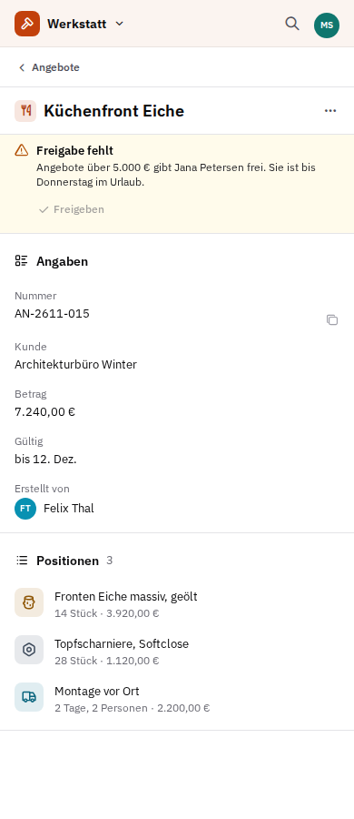

The head `Bar` holds `Tabs`, a `Popover tip` on the refresh button, a
`Menu` "Filter" with ticked entries (a `Popover` in the head leaves on the phone),
a `Menu` with a choice section and toggles, and the
one primary as a `Menu` with a submenu. Each `Row` stands in a
`Menu.Context`, leads with the mark of its kind and has a `Button pressed`
star and a "…" `Menu` with the same entries in its `end`. The offer the address names opens in a
`Pane detail` with its own deeds; `Button busy` while it sends, and a
`Notice` with a `disabled` action that says why.

- One list of entries feeds the row's "…" and its right-click.
- Deleting answers with a toast and "Rückgängig".

## dialogs.tsx: a dialog, a question, a toast

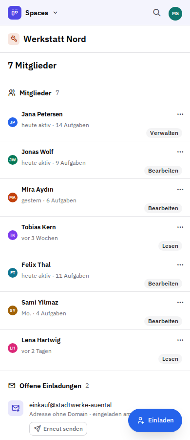

Members of a space (its `Mark` in the head, the spaces with theirs in the
`Nav`) as rows with avatars, their role and last activity in the second
line; open invitations with a mark. "Einladen" opens a `Dialog` with
`Field`s and its own primary in the foot (a sheet on the phone);
`Workspace primary` opens the same dialog. Removing a member asks with
`Dialog.confirm`, then a toast offers "Rückgängig"; "Erneut senden"
answers with a toast with `status` `ok` or `bad`.

- A menu entry that opens `Dialog.confirm` returns nothing (`void`), so
  the menu closes while the question asks.
- The open state of the dialog lives in the screen (`open`,
  `onOpenChange`).

## states.tsx: the states of a list

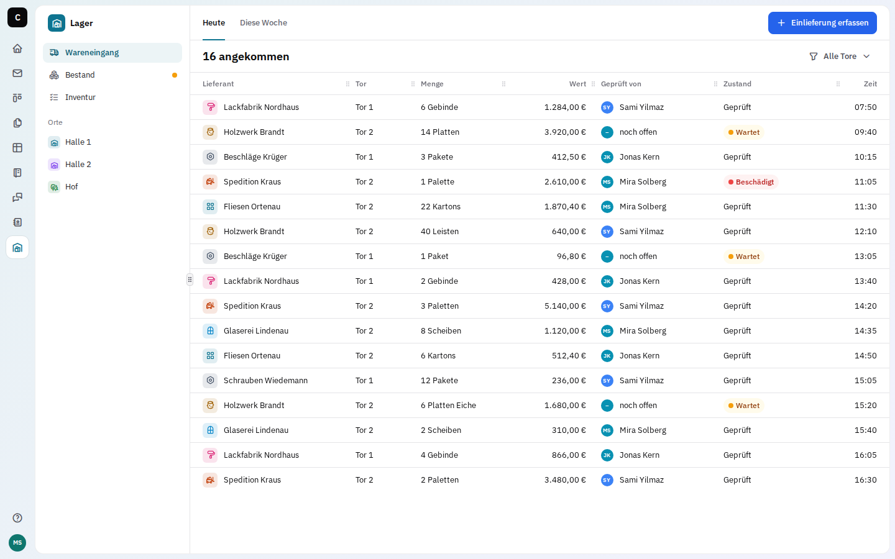

A list of deliveries, each with the mark of its goods and a state chip,
with a `StatusRow` and its states in the place of the rows:
`Empty` for nothing yet and another `Empty` for nothing behind a
filter, `Loading` with the rows and lines that usually come, `Failed`
with "Erneut versuchen". A `Notice tone="bad"` names the deed for a
problem a person must fix; a connection that retries on its own says so in
the `StatusRow` facts.

- The head and the status row never move between the states.

## content.tsx: a page to read

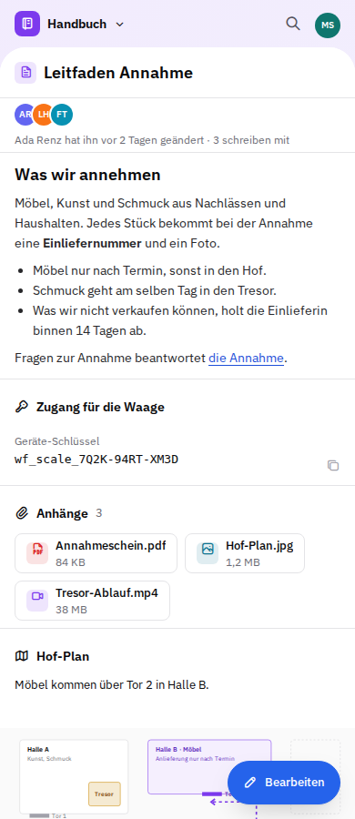

A `Nav` with the areas of the handbook and their marks; a head `Bar`
with the page's `Mark` and its title as `Text type="lead"` in `Inline`, a
ghost "Teilen" and the one primary "Bearbeiten" (mirrored as `Workspace
primary`); a status `Bar` with the writers as `Avatar.Stack` and who
changed it last; a `Band`
with the text as `Prose markdown` (rendered safely: no raw HTML, no images,
only web and mail links); a `Section` with a key in `Facts` (`mono`,
`copy`); the files as `Tiles` with the colour of their type in a
`Section` with a count; a plan of its own
in a `Canvas` with `height`, directly in its `Section`. `states` exports
empty (`Empty` with "Text schreiben"), loading (`Loading` rows) and failed
(`Failed`), each in place of the text below the head.

- Writing the text happens behind "Bearbeiten": the Markdown editor of
  `@k2b/editor` has no v2 form yet (gap).
- Code to read and copy is a `Facts` item with `mono` and `copy`; a code
  block with highlighting is a gap. Media open from their `Tiles`; an image
  or video viewer is a gap.
- A chart is a `Chart` of `@k2b/ui` in a `Canvas` in its `Section`, sized
  `style={{ height: "100%" }}`. Inside `.k2-ui` it takes the v2 font, the
  meta role (12 px), the v2 inks and lines, the surface as separator in
  both themes, the text edge in a `Canvas`, and a tooltip like a v2
  overlay. It needs the `@k2b/ui` stylesheet and a `.k2b-ui` ancestor, which
  every Cloud page has; with `v2.css` alone a chart has no size (gap), so
  this recipe draws its plan itself.
- With no data, put `Empty` in place of the `Canvas`. `Loading` and
  `Failed` hold rows, not the height of a drawing, so the page moves while a
  chart loads (gap).
