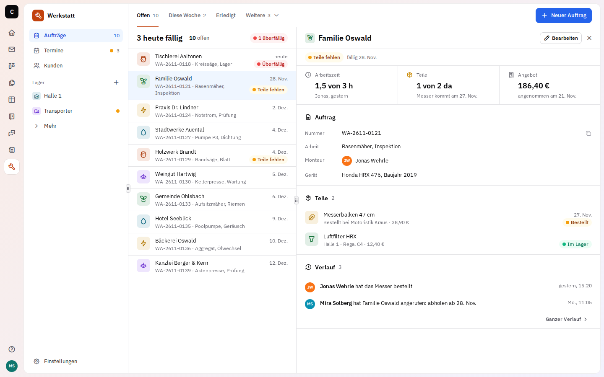
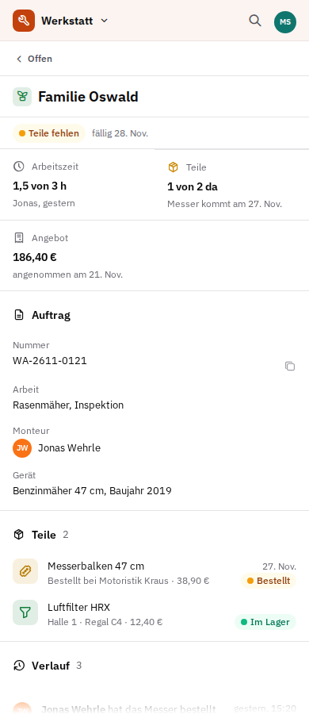
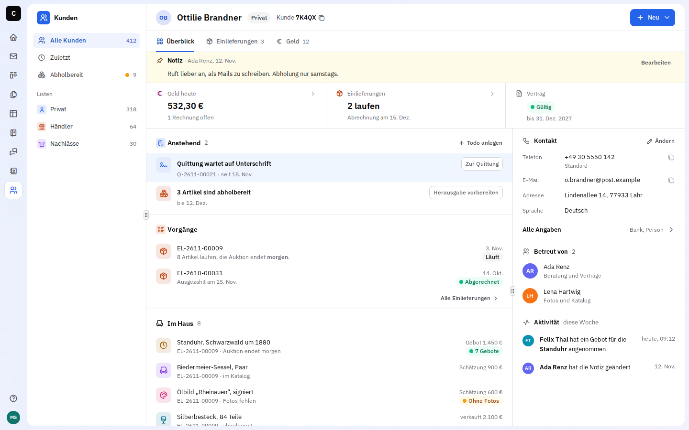
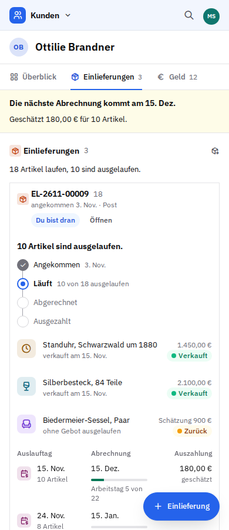
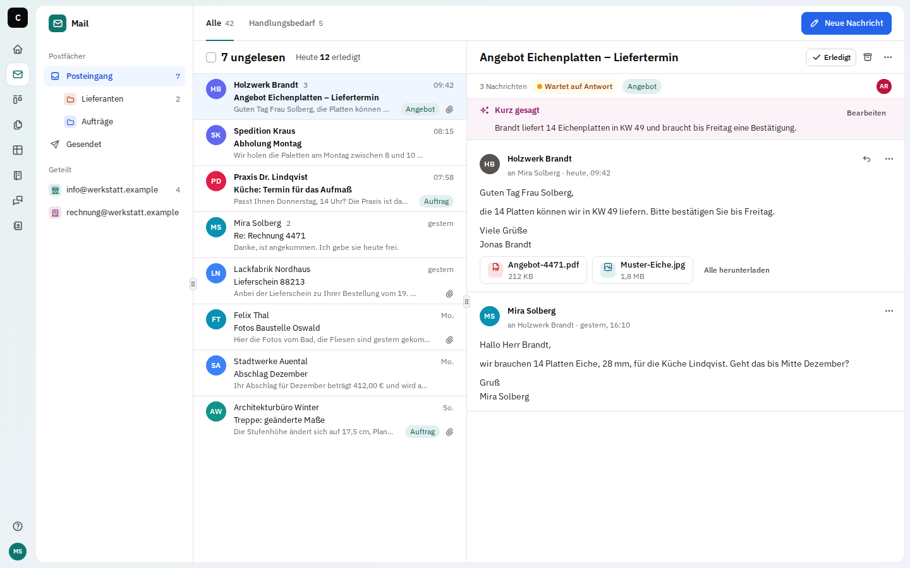

# Recipes

A recipe is a whole screen in one file under `recipes/`, with sample data at
the top and one default export. Copy the file, keep its structure, replace
the data. The pictures in `images/` are drawn from these files by
`packages/ui/scripts/v2-preview.ts` (light, 1440 and 390 px), and a browser
test keeps every recipe free of findings, so code and picture always match.

Read the recipe file next to its picture: each part in the code is one
thing you can point at in the image.

Most recipes also export `states`: the same screen empty, loading, failed
or in another state that fits it (a form while it saves). Fibel's examples
switch between them, and the browser test checks each one. A state stands
where the data would stand; the head and the status row never move.

## frame.tsx: the frame of an app

`Workspace` with `detail` and `detailEmpty`; a `Nav` with two groups
(a group `action`, a `dot`, a folding "Mehr", a `foot`); a head `Bar`
with `Tabs` (a menu tab "Weitere") and the one primary, mirrored as
`Workspace primary`; a list `Pane` with `width`, `scrollKey` and a
`StatusRow`; the open entry as `Pane detail` with `back`, a head `Bar`
and a status `Bar` with `Inline` chips.

- What is open comes from the address. Without an open entry the detail is
  not rendered (`undefined`, never `false`), and `detailEmpty` holds its
  place, so nothing moves when it opens.
- On a tablet the sidebar becomes a drawer behind a button in the head; on
  the phone the open entry is the page and `back` is its one way back.
- States: `closed`, `empty`, `loading`, `failed`.

## list-detail.tsx: a list beside the open entry

`Workspace` with `Nav`, a head `Bar` with `Tabs` and the main action;
`Pane.Split` with the list (`StatusRow`, `List` of two-line `Row`s, the open
one `current`) and a `Pane detail` (head `Bar` with the name and actions,
`Notice tone="bad"` with a way out, `Section`s with `Facts` and `Row`s).

- On the phone the detail pane leaves. Open an entry as its own route there.
- An error of the open entry is a `Notice` at the top of the detail, not a
  red text somewhere.

## form.tsx: a form with server errors and a conflict

`Notice tone="warn"` for a conflict that blocks saving; `Band`s of `Field`s
(`Field.Row` for fields side by side); a server error goes into the `error`
of its field; `Choice` and `Check switch` for options; a `Bar` at the end
with "Cancel" and the one primary "Save", disabled while the conflict lasts.

- Validation and server answers live in the app's state; the primitives
  only show `error`.
- A form that opens over the page is a `Dialog` (a sheet on the phone);
  this one has a page of its own.
- States: `fresh` (nothing sent yet), `errors` ("Pflichtfeld." and the
  server's errors at their fields), `saving` (`Button busy`).

## form-detail.tsx: a form beside a list

The page's one primary "Neuer Termin" stays in the head; the form is a
`Pane detail` beside the list, so the list stays in view while it is
filled in, with `Select`, `DateInput`, `Input`, `Choice` inside a `Field`, a
multiline `Input`, and `Check`s, one of them `disabled` with the reason
in its words. Its footer `Bar` saves with a default button.

- A form beside a page with a head primary never gets a second primary.
- On the phone the form is the page; `back` leads to the list.
- States: `errors`, `saving`.

## record.tsx: a record, first tab

`RecordHead` in the head `Bar`; `Tabs` as the head of the record's `Pane`.
Across both columns: a pinned `Notice tone="note"` and `Cells` with the key
statements. Below them a `Pane.Split`: the main column with
`Section "Anstehend"` (`Row yours`, row actions) and a `Section` with a
`Digest` and a `more` link; a `Pane side` with a `Canvas` (map) and
`Section` + `Facts`.

- What needs a person comes first; history comes after.
- Area colours (`color`) mark the same area in cells, sections and groups
  (tabs carry no colour).
- States: `empty` (a new customer), `loading` and `failed` (the history,
  which loads on its own: its state stands in its section).

## record-groups.tsx: a record tab with groups

A `Band tone="note"` with the one statement of the tab; one `Section` for
the area with a `summary`; one `Group` per delivery with
`meta`, a `state` chip and actions. Inside a group: a strong sentence, its
way as `Steps`, a `Table` with two-line cells and `Progress`, `Facts inline`
with a print button. A finished group is `folded`.

- Never a `Group` inside a `Group`, never a line inside one.
- "You are next" is `Chip yours`, not a red badge.
- States: `empty`, `loading`, `failed`, in the place of the groups.

## mail.tsx: a list with a reader

Three-line `Row`s (sender, subject, preview) with `unread`, `meta` count,
`time` and `marks`; `StatusRow` with select-all. The reader: head `Bar`
with the subject as `Text type="lead"` and actions; a `Bar` with `Inline`
chips; `Notice tone="ai"` for the summary; one `Band` per message with a
sender `Row` (avatar, icon buttons in `end`), `Prose`, `Tiles`.

- A colleague's internal note in the thread is a `Notice tone="note"` with
  `title` and `meta` (who, when).
- The reply: until the composer of `@k2b/editor` arrives (gap), a `Band`
  with a `Field` and `<Input multiline />`, followed by a `Bar` whose `end`
  holds "Senden" as a default button (the page's primary stays "Neue
  Nachricht").

## table.tsx: a table with a status row

`StatusRow` with the lead ("3 offen"), facts (sum, overdue) and a filter
button at the end; `Table` with widths, a status `Chip`, an amount column
`align: "end"`, one text button per row, `drop` on the columns that matter
least, and `phone(row)` so the phone shows two-line rows instead of a cut
table. `open(row)` gives each row the address of its invoice (on the phone
too); `empty` says "Keine offenen Rechnungen." in place of the table, and
`loading` would hold its place while the rows load.

- The lead says the one thing; the rest are facts, which leave on the phone.
- A deed per row is a `Button variant="text"` in its own last column.
