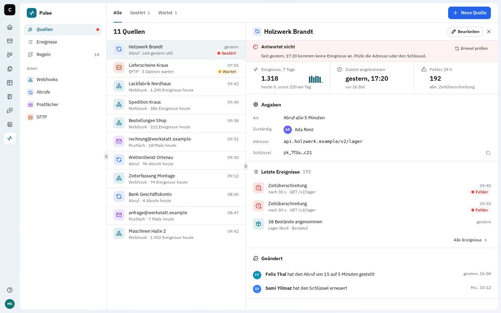
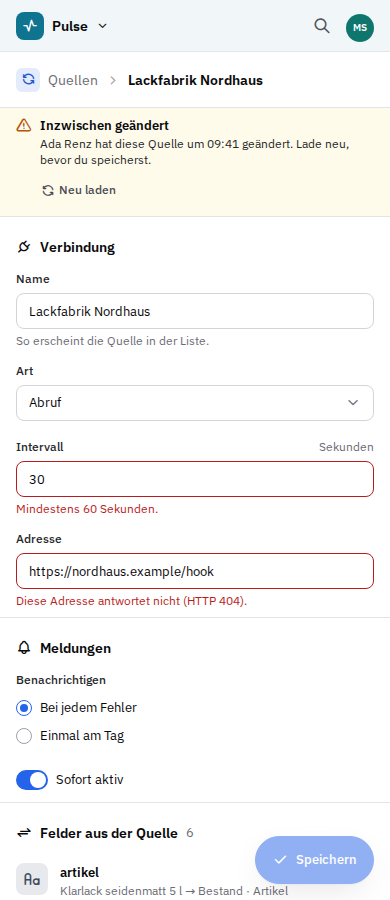
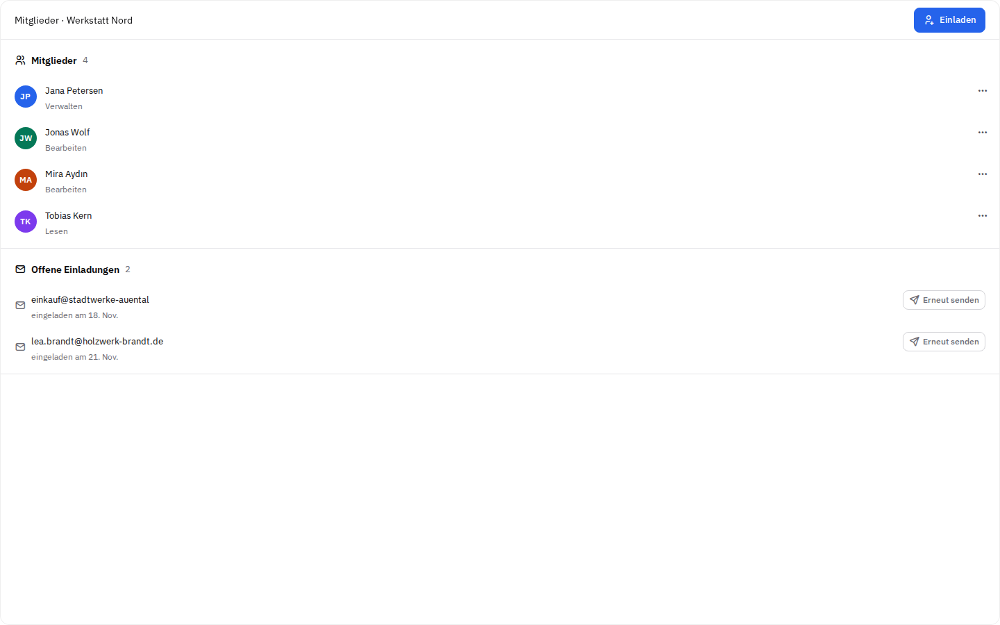
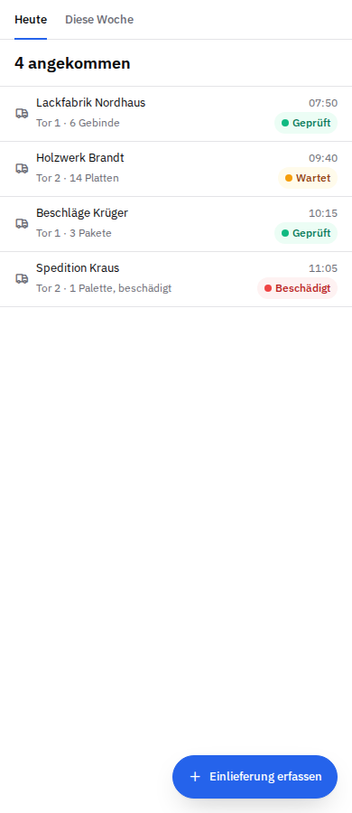

# Recipes

A recipe is a whole screen in one file under `recipes/`, with sample data at
the top and one default export. Copy the file, keep its structure, replace
the data. The pictures in `images/` are drawn from these files by
`packages/ui/scripts/v2-preview.ts` (light, 1440 and 390 px), and a browser
test keeps every recipe free of findings, so code and picture always match.

Read the recipe file next to its picture: each part in the code is one
thing you can point at in the image.

A recipe may also export `states`: its other states by name, such as
`empty: () => <Screen rows={[]} />`. A state that shows an open menu,
panel, dialog or toast is `{ render, press }`: the screen, and the names
of the buttons and menu entries a person presses, in order, to open it.
The browser tests render every state, and Fibel's examples offer them.

## list-detail.tsx: a list beside the open entry

`Workspace` with `Nav`, a head `Bar` with `Tabs` and the main action;
`Pane.Split` with the list (`StatusRow`, `List` of two-line `Row`s, the open
one `current`) and a `Pane detail` (head `Bar` with the name and actions,
`Notice tone="bad"` with a way out, `Section`s with `Facts` and `Row`s).

- On the phone the detail pane leaves. Open an entry as its own route there.
- An error of the open entry is a `Notice` at the top of the detail, not a
  red text somewhere.

## form.tsx: a form with server errors and a conflict

`Notice tone="warn"` for a conflict that blocks saving; `Band`s of `Field`s
(`Field.Row` for fields side by side); a server error goes into the `error`
of its field; `Choice` and `Check switch` for options; a `Bar` at the end
with "Cancel" and the one primary "Save", disabled while the conflict lasts.

- Validation and server answers live in the app's state; the primitives
  only show `error`.
- A long form stands in its own pane or route; a short task above the page
  is a `Dialog` (see `dialogs.tsx`).

## record.tsx: a record, first tab

`RecordHead` in the head `Bar`; `Tabs` as the head of the record's `Pane`.
Across both columns: a pinned `Notice tone="note"` and `Cells` with the key
statements. Below them a `Pane.Split`: the main column with
`Section "Anstehend"` (`Row yours`, row actions) and a `Section` with a
`Digest` and a `more` link; a `Pane side` with a `Canvas` (map) and
`Section` + `Facts`.

- What needs a person comes first; history comes after.
- Area colours (`color`) mark the same area in cells, sections and groups
  (tabs carry no colour).

## record-groups.tsx: a record tab with groups

One `Section` for the area with a `summary`; one `Group` per delivery with
`meta`, a `state` chip and actions. Inside a group: a strong sentence, its
way as `Steps`, a `Table` with two-line cells and `Progress`, `Facts inline`
with a print button. A finished group is `folded`.

- Never a `Group` inside a `Group`, never a line inside one.
- "You are next" is `Chip yours`, not a red badge.

## mail.tsx: a list with a reader

Three-line `Row`s (sender, subject, preview) with `unread`, `meta` count,
`time` and `marks`; `StatusRow` with select-all. The reader: head `Bar`
with the subject as `Text type="lead"` and actions; a `Bar` with `Inline`
chips; `Notice tone="ai"` for the summary; one `Band` per message with a
sender `Row` (avatar, icon buttons in `end`), `Prose`, `Tiles`.

- A colleague's internal note in the thread is a `Notice tone="note"` with
  `title` and `meta` (who, when).
- The reply: until the composer of `@k2b/editor` arrives (gap), a `Band`
  with a `Field` and `<Input multiline />`, followed by a `Bar` whose `end`
  holds "Senden" as a default button (the page's primary stays "Neue
  Nachricht").

## table.tsx: a table with a status row

`StatusRow` with the lead ("3 offen"), facts (sum, overdue) and a filter
button at the end; `Table` with widths, a status `Chip`, an amount column
`align: "end"`, one text button per row, `drop` on the columns that matter
least, and `phone(row)` so the phone shows two-line rows instead of a cut
table. `open(row)` gives each row the address of its invoice (on the phone
too); `empty` says "Keine offenen Rechnungen." in place of the table, and
`loading` would hold its place while the rows load.

- The lead says the one thing; the rest are facts, which leave on the phone.
- A deed per row is a `Button variant="text"` in its own last column.

## actions.tsx: where deeds stand

The head `Bar` holds `Tabs`, a `Popover tip` on the refresh button, a
`Popover` filter panel, a `Menu` with a choice section and toggles, and the
one primary as a `Menu` with a submenu. Each `Row` stands in a
`Menu.Context` and has a `Button pressed` star and a "…" `Menu` with the
same entries in its `end`. The offer the address names opens in a
`Pane detail` with its own deeds; `Button busy` while it sends, and a
`Notice` with a `disabled` action that says why.

- One list of entries feeds the row's "…" and its right-click.
- Deleting answers with a toast and "Rückgängig".

## dialogs.tsx: a dialog, a question, a toast

Members of a space in `Section`s. "Einladen" opens a `Dialog` with
`Field`s and its own primary in the foot (a sheet on the phone);
`Workspace primary` opens the same dialog. Removing a member asks with
`Dialog.confirm`, then a toast offers "Rückgängig"; "Erneut senden"
answers with a toast with `status` `ok` or `bad`.

- A menu entry that opens `Dialog.confirm` returns nothing (`void`), so
  the menu closes while the question asks.
- The open state of the dialog lives in the screen (`open`,
  `onOpenChange`).

## states.tsx: the states of a list

A list with a `StatusRow` and its states in the place of the rows:
`Empty` for nothing yet and another `Empty` for nothing behind a
filter, `Loading` with the rows and lines that usually come, `Failed`
with "Erneut versuchen". A `Notice tone="bad"` names the deed for a
problem a person must fix; a connection that retries on its own says so in
the `StatusRow` facts.

- The head and the status row never move between the states.
