# Recipes

A recipe is a whole screen in one file under `recipes/`, with sample data at
the top and one default export. Copy the file, keep its structure, replace
the data. The pictures in `images/` are drawn from these files by
`packages/ui/scripts/v2-preview.ts` (light, 1440 and 390 px), and a browser
test keeps every recipe free of findings, so code and picture always match.

Read the recipe file next to its picture: each part in the code is one
thing you can point at in the image.

Every recipe shows a real screen in the look of the skill ("The look"):
a sidebar with the app's places, each thing with its mark or avatar,
states as colour and word, people beside what they did, ten rows and
more of dense German sample data. The export `app` (`{ color, icon }`)
names the app the screen belongs to; the pictures, Fibel and the tests
draw every recipe in the frame of its host (a tinted page with a rail of
apps, the app marked in it). A browser test fails a recipe whose rows,
table rows or tiles show a thing without its `Mark` or `Avatar`.

Most recipes also export `states`: the same screen empty, loading, failed
or in another state that fits it (a form while it saves). Fibel's examples
switch between them, and the browser test checks each one. A state stands
where the data would stand; the head and the status row never move. A
state that shows an open menu, panel, dialog or toast is `{ render, press }`:
the screen, and the names of the buttons and menu entries a person presses,
in order, to open it.

Each recipe starts with its screen brief, as every new screen does (its pull
request carries the same): who uses it for what, the three most important
pieces of information in order, the hero (where the eye lands first), and
the layout at 390, 1024, 1440 and 1920 px. Copy the brief with the recipe
and rewrite it for your screen before you build anything. A 1920 line that
says "not built yet" names a gap: a large screen deserves a deliberate
further column, never a wider list.

## frame.tsx: the frame of an app

**Brief.** A workshop lead plans today's orders. 1: what is due today and
what is late; 2: the open order's figures, parts and history; 3: the
other views. Hero: the open order's figures. 390: the list, an order as
its own page. 1024: list beside the detail, the sidebar a drawer. 1440:
sidebar, list, detail. 1920: not built yet (a third column with the
order's parts and history beside its figures).

`Workspace` with `detail` and `detailEmpty`; a `Nav` with two groups
(a group `action`, a `dot`, a folding "Mehr", a `foot`); a head `Bar`
with `Tabs` (a menu tab "Weitere") and the one primary, mirrored as
`Workspace primary`; a list `Pane` with `width`, `scrollKey` and a
`StatusRow`; the open entry as `Pane detail` with `back`, a head `Bar`
with the thing's `Mark` before its name, a status `Bar` with `Inline`
chips, `Cells` with its figures, `Facts` with the person in charge as an
avatar, its parts as rows with marks and state chips, and its history as
`Digest activity`. Every order leads with the mark of its machine; only a
state that is not "in plan" speaks up as a chip in `marks`.

- What is open comes from the address. Without an open entry the detail is
  not rendered (`undefined`, never `false`), and `detailEmpty` holds its
  place, so nothing moves when it opens.
- On a tablet the sidebar becomes a drawer behind a button in the head; on
  the phone the open entry is the page and `back` is its one way back.
- States: `closed`, `empty`, `loading`, `failed`.

## tree.tsx: folders as a tree

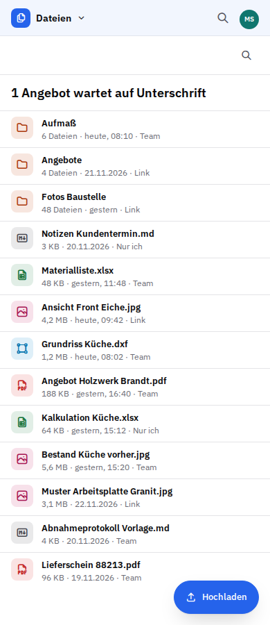

**Brief.** Someone files and finds project files. 1: what in this folder
waits (an offer to sign); 2: its files with kind, owner and sharing; 3:
where it lies (path, tree). Hero: the statement of what waits. 390: the
top level as two-line rows, the tree in the drawer. 1024: the table drops
owner and sharing as room runs out. 1440: tree beside the full table.
1920: not built yet (a preview of the open file beside the table).

`Nav` with a plain group ("Zuletzt", "Favoriten", "Freigaben") and a
group with `tree`: the storages with their `color` (so each leads with its
`Mark`), their folders with counts and a `dot` ("Küche Lindqvist" is
`current`, so the way to it is open; closed folders are `branch` and load
on the first open; "Fotoarchiv" has `more`), and the storage's `quota`.
A head `Bar` with the `Path`, a search and the one create action, a primary
`Menu` ("Dateien hochladen", "Neuer Ordner"); a `Pane` with a `StatusRow`
that says what waits, and a `Table` with `tree`: folders and
files as rows in levels, each with the mark of its kind (`Column mark`),
its owner (`Column avatar`) and how it is shared (symbol and word, or a
status chip when it waits for someone); the open file is `current`, so
its folder starts open.

- Give the loaded nodes down to the open place; the rest loads through
  `load` and `loadMore` when a person opens it. Never load the whole tree.
- On the phone the sidebar is a drawer with the same tree, and the table
  shows its top level; a folder opens as its own page.

## list-detail.tsx: a list beside the open entry

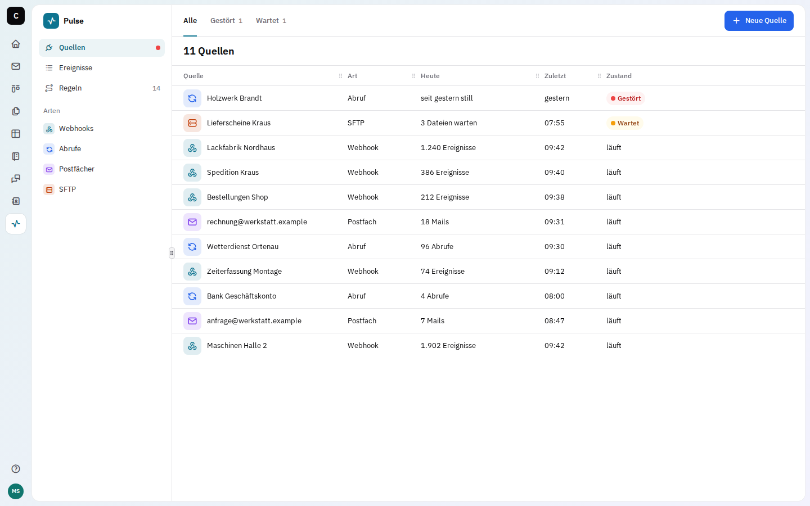
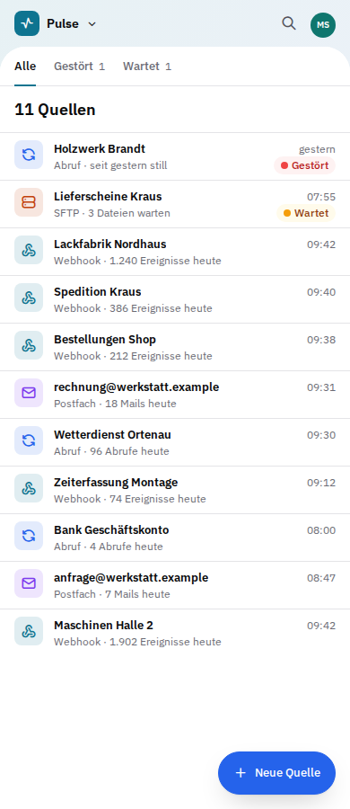

**Brief.** Someone keeps data sources running. 1: which source is broken
and why; 2: its figures and latest events; 3: how the others are. Hero:
the broken source's notice and figures. 390: two-line rows, a source as
its own page. 1024 and 1440: with none open a dense table across the
page; with one open, rows beside its detail. 1920: not built yet (the
open source's event log as a third column).

`Workspace` with `Nav`, a head `Bar` with `Tabs` and the main action;
`Pane.Split` with the list (`StatusRow` with the count; the troubled ones
are counted once, in the `Tabs`; `List` of two-line `Row`s with the mark
of their kind, a state chip only where something is wrong, the open one
`current`) and a `Pane detail` (head `Bar` with mark, name and actions,
`Notice tone="bad"` with a way out, `Cells` with a `trend`, `Facts` with
the person in charge, the latest events as rows with marks, and who
changed it as `Digest activity`). With no entry open (state `closed`) the
`Workspace` has no `detail`, and the sources stand as a dense `Table`
across the page: one line each, the same marks, a chip only where
something is wrong; its `phone(row)` gives the same two-line rows.

- On the phone the detail pane leaves. Open an entry as its own route there.
- An error of the open entry is a `Notice` at the top of the detail, not a
  red text somewhere.

## form.tsx: a form with server errors and a conflict

**Brief.** Someone changes how a source connects. 1: what blocks saving
(the conflict, a field in error); 2: the fields; 3: what the source feeds
and who changed it. Hero: the conflict notice, then the field in error.
390: one column, the deeds at the form's end. 1024 and 1440: the form
beside a side column of what it feeds. 1920: not built yet (the fields of
the last delivery beside the form instead of under it).

A `Path` with the thing's mark in the head; `Notice tone="warn"` for a
conflict that blocks saving; `Section`s of `Field`s (`Field.Row` for
fields side by side); a server error goes into the `error` of its field;
`Choice` and `Check switch` for options; the form ends with a `Bar` of
"Abbrechen" and the one primary "Speichern", disabled while the conflict
lasts (on the phone too, so no `Workspace primary` says it twice); a
`Pane side` with what the thing feeds (rows with marks and a state chip)
and who changed it (`Digest activity`).

- Validation and server answers live in the app's state; the primitives
  only show `error`.
- Settings are not a form: they stand as rows of label and hint with the
  value at a fixed width beside them (rule 10 of "The look").
- A long form stands in its own pane or route; a short task above the page
  is a `Dialog` (see `dialogs.tsx`).
- States: `fresh` (nothing sent yet), `errors` ("Pflichtfeld." and the
  server's errors at their fields), `saving` (`Button busy`).

## form-detail.tsx: a form beside a list

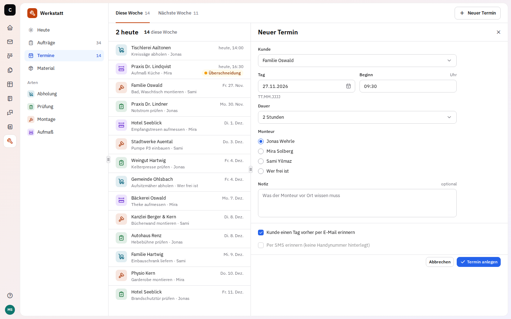
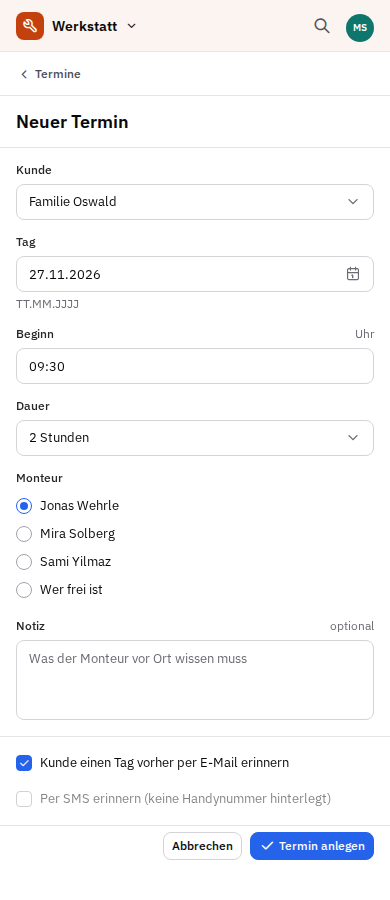

**Brief.** Someone books an appointment while the week stays in view. 1:
the fields to fill; 2: clashes in the week; 3: how many are today. Hero:
the open form. 390: the form is the page, its way back leads to the week.
1024 and 1440: the week's list beside the form. 1920: not built yet (the
chosen fitter's day beside the form).

"Neuer Termin" in the head opened the form; the list shows each
appointment with the mark of its kind and the fitter in its second line,
and a clash as a chip; the form is a `Pane detail` beside the list, so the
list stays in view while it is filled in, with `Select`, `DateInput`,
`Input`, `Choice` inside a `Field` (fields stand in one column of a fixed
width), a multiline `Input`, and `Check`s, one of them `disabled` with the
reason in its words. Its footer `Bar` holds the page's one primary,
"Termin anlegen".

- While the form is open, "Termin anlegen" is the one create action:
  neither the head nor the phone offers "Neuer Termin" beside it.
- On the phone the form is the page; `back` leads to the list.
- States: `errors`, `saving`.

## pairing.tsx: pairing a device

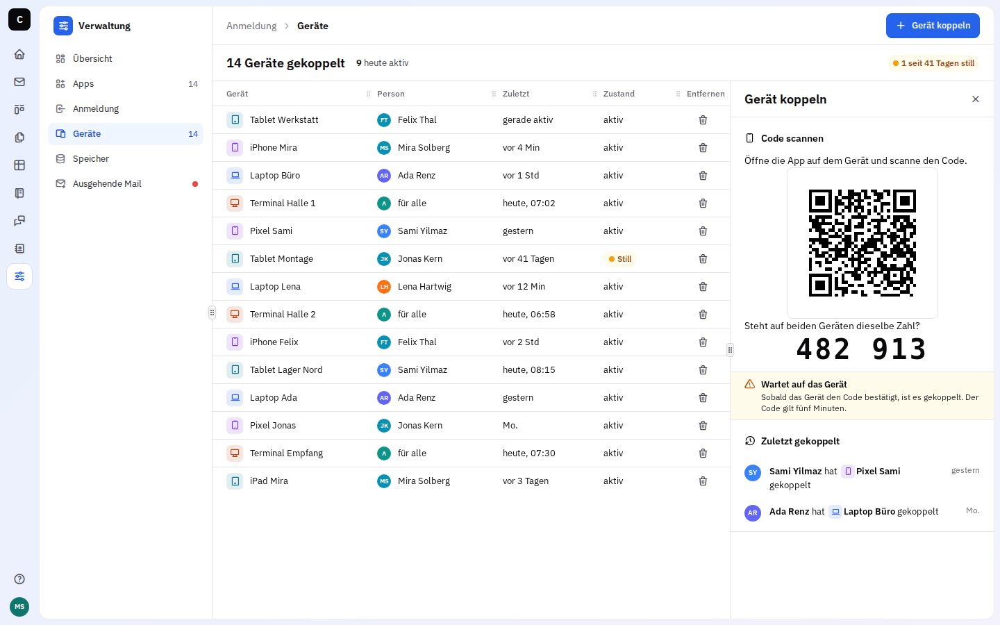
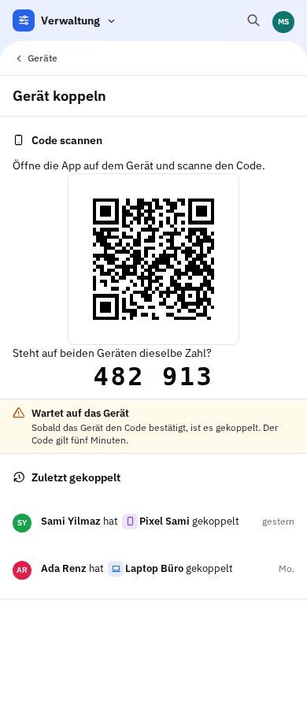

**Brief.** An admin connects a device. 1: the code to scan and the code
to compare; 2: whether the other device answered; 3: the paired devices
and the one that went quiet. Hero: the QR code. 390: the pairing as its
own page. 1024 and 1440: the devices' table beside the pairing while it
runs, the table alone after. 1920: not built yet.

The head holds the views as `Tabs` (the place is the open `Nav` entry);
the paired devices as a `Table`: the device with the mark of its kind,
its person with an avatar, when it was last seen, a chip only where a
device is off, and an icon button that removes the device after
`Dialog.confirm({ …, danger: true })`. "Gerät koppeln" opens a
`Pane detail` beside them, only while the pairing runs, with a
`Section` with `id` (a link target): the steps as `Text`, a `QrCode` (the
app makes its SVG with `@k2b/stdlib/qr`) and the code to compare as
`CodeDisplay`; the wait for the other device is a `Notice tone="warn"`,
which assistive technology hears politely; under it the latest pairings
as `Digest activity`.

- Steps of a pairing in a dialog: `Dialog stepwise`, so a shorter step
  does not make it jump.
- States: `closed` (no pairing runs: the table is the page), `paired`
  (the new device stands first in the list).

## settings.tsx: settings with more than text

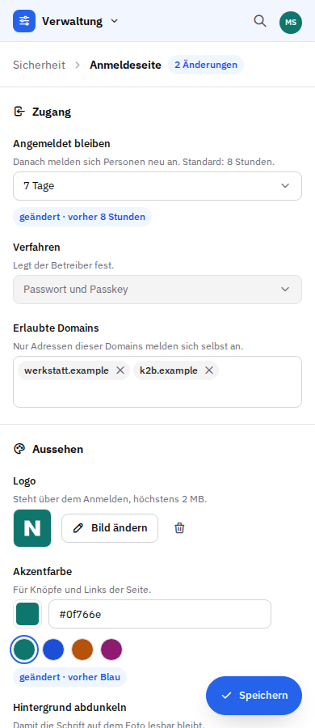

**Brief.** An admin shapes the sign-in page. 1: what is not saved yet; 2:
each setting's value; 3: who changed what. Hero: the page's title with
its changes. 390: one column, each label over its value. 1024 and 1440:
label and hint on the left, the values in one column, the history beside
them. 1920: not built yet (a live preview of the sign-in page as a third
column).

The sign-in page of an administration as `Setting` rows in `Section`s:
a `Select` with `was` (the value before the unsaved change), a `Select`
the operator fixed (`disabled`, the reason in the hint), allowed domains
in a `TagsInput`, a logo in an `ImageInput`, an accent colour in a
`ColorInput`, how dark the background is in a `Slider`. The head names
the page and in one line what it is for, says how many changes wait and
holds "Verwerfen" and the one primary "Speichern" (k2b-ui gap: a footer
that stays at the pane's bottom while there are changes); a `Pane side`
shows who changed what (`Digest activity`).

- A choice the person may not change is a dimmed control with the reason
  in its hint, not a missing one.
- A field's deed (`Field action`, such as "Auf Standard zurücksetzen") has
  no place in a `Setting` row yet (k2b-ui gap); name the default in the
  hint.
- States: `empty`, `locked`.

## record.tsx: a record, first tab

**Brief.** A dealer at the counter with a customer. 1: money and
deliveries today; 2: what is coming (pickups, deadlines); 3: the history
and who looks after the customer. Hero: the key figures under the
customer's name. 390: the figures two to a row, then the sections. 1024
and 1440: a main and a side column. 1920: not built yet.

`RecordHead` in the head `Bar`; `Tabs` as the head of the record's `Pane`.
Across both columns: a pinned `Notice tone="note"` and `Cells` with the key
statements. Below them a `Pane.Split`: the main column with
`Section "Anstehend"` (`Row yours` with marks, row actions), the
deliveries as rows (id over its sentence, the date at the end, the state
as a chip) with a `more` link, and the customer's articles as rows
with the mark of their category, price and state; a `Pane side` with the
contact `Facts`, the people who look after the customer as rows with
avatars, and `Digest activity`.

- What needs a person comes first; history comes after.
- Area colours (`color`) mark the same area in cells, sections and groups
  (tabs carry no colour).
- The data comes as one object (`Customer`); the screen only places it.
- States: `worst` (the same customer at its limits: long compound names,
  one letter, right-to-left and Chinese script, joined emoji, ten-digit
  amounts, ids that cannot wrap, a deleted person), `empty` (a new
  customer), `loading` and `failed` (the history, which loads on its own:
  its state stands in its section).

## record-groups.tsx: a record tab with groups

**Brief.** The same dealer on the customer's deliveries. 1: the delivery
that waits for this person; 2: each delivery's step and state; 3: the
done ones, folded. Hero: the delivery that waits. 390: the groups one
under the other. 1024 and 1440: the groups with their steps across. 1920:
not built yet.

A `Notice tone="note"` with its icon and the one statement of the tab;
one `Section` for the area with a `summary`; one `Group` per delivery
with `meta`, a `state` chip and actions. Inside a group: a strong sentence, its
way as `Steps`, its articles as rows with their marks and a state chip, a
`Table` with two-line cells and `Progress`, `Facts inline` with a print
button. A finished group is `folded`. The sidebar holds the app's places
and lists with their marks.

- Never a `Group` inside a `Group`, never a line inside one.
- "You are next" is `Chip yours`, not a red badge.
- States: `worst` (the same tab at its limits, as in `record.tsx`),
  `empty`, `loading`, `failed`, in the place of the groups.

## mail.tsx: a list with a reader

**Brief.** Someone works their inbox. 1: what is unread and needs an
answer; 2: the open message and its summary; 3: its files. Hero: the open
message. 390: the list, a message as its own page. 1024 and 1440: the
list beside the reader. 1920: not built yet (the sender's other threads
and contact as a third column).

Three-line `Row`s (sender, subject, preview) with the sender's `avatar`,
`unread`, `meta` count, `time` and `marks`; mailboxes and shared mailboxes
in the `Nav` with their colours and the unread count; `StatusRow` with
select-all and what it takes. The reader: head `Bar` with the subject as
`Text type="lead"` and actions; a `Bar` with `Inline` chips; `Notice
tone="ai"` for the summary; one `Band` per message with a sender `Row`
(avatar, icon buttons in `end`), `Prose`, `Tiles` with the colour of each
file type.

- A colleague's internal note in the thread is a `Notice tone="note"` with
  `title` and `meta` (who, when).
- The reply: until the composer of `@k2b/editor` arrives (gap), a `Band`
  with a `Field` and `<Input multiline />`, followed by a `Bar` whose `end`
  holds "Senden" as a default button (the page's primary stays "Neue
  Nachricht").

## overview.tsx: an overview of things with a face

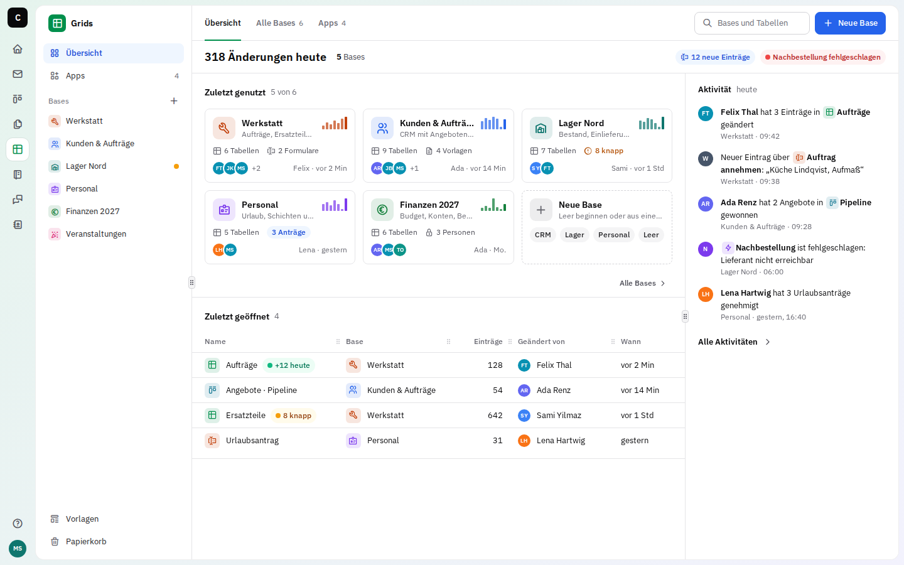

**Brief.** Someone comes back to their bases. 1: what failed or needs
them; 2: the recently used bases with their activity; 3: the recently
opened tables. Hero: the base cards with their sparks. 390: the cards in
one column. 1024 and 1440: cards in rows, the activity beside them. 1920:
not built yet.

The bases of Grids. `Nav` entries with `color`, so each base leads with its
`Mark`; a `StatusRow` whose lead says what counts today, with chips for
what lets a person act; `Tiles variant="card"` with `stats`, `people`,
`foot`, `trend` and the `create` card with templates as `choices`; a
`Table` of what was opened last (the thing and its base with their marks,
entries, who changed it with an avatar, when); a
`Pane side` with `Digest activity`, each sentence with the thing's
`Mark` and name.

- A base has one colour and symbol, the same in the sidebar, on its card
  and in a sentence. A kind of thing (table, board, form) has one colour
  across the app.
- A form or a workflow that did something is a person with its name.
- States: `empty` (a new installation; the card that makes a base stays).

## home.tsx: the home of one place

**Brief.** Someone opens one place to see how it stands. 1: its key
figures; 2: its parts and what changed in them; 3: who did what. Hero:
the key figures. 390: the figures two to a row, then the sections. 1024
and 1440: sections side by side. 1920: not built yet.

One base: four `Cells` (a `trend` on the first; a number with a tinted
chip beside it, never inside), the groups as `Section`s side by side in
`Section.Columns`, each of strong `Row`s with `mark`, their figures in the
second line and their state as a chip in `marks`; then `Digest activity`
under "Zuletzt geändert", each time at the end of its sentence.

- A state that needs a person (a failed workflow, new form entries) stands
  in its row and as a `dot` on its sidebar entry.
- States: `quiet` (a day without anything that needs a person).

## files.tsx: a folder with list, grid and selection

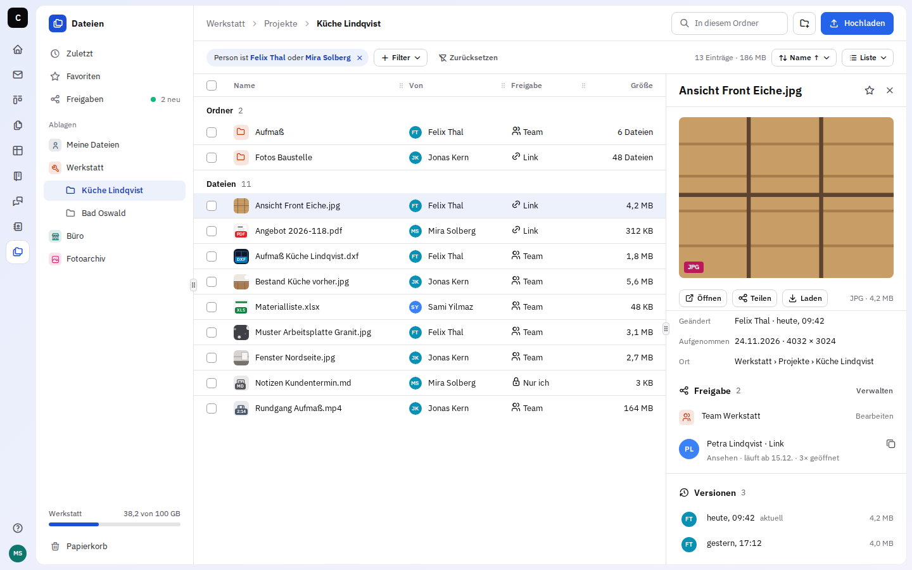

**Brief.** Someone works in a project folder. 1: its files with
thumbnails and kinds; 2: the open file (preview, sharing, versions); 3:
the filters and a selection. Hero: the open file's preview. 390: the
list, a file as its own page. 1024 and 1440: the list beside the open
file. 1920: not built yet.

Two full-width rows above list and detail: a head `Bar` with `Path`, a
sharing `Chip`, the search, "Neuer Ordner" and the primary "Hochladen";
then the `FilterBar` with `results` and `end` (`ListOrder`, a `Menu` for
list or grid). The list is a `Table` with `select`, `group` (folders,
files), a `mark` column with thumbnails and types, an `avatar` column; the
open file is a `Pane detail` with `Preview`, a bar of deeds, `Facts` and
sections for sharing and versions. `Nav` shows storages with `color` and
the storage's `quota`.

- While files are selected, `StatusRow selection` takes the bar's place at
  the same height; on the phone its actions float at the bottom.
- States: `grid` (`Tiles variant="media"`), `selecting` (three photos).

## settings-page.tsx: a settings page

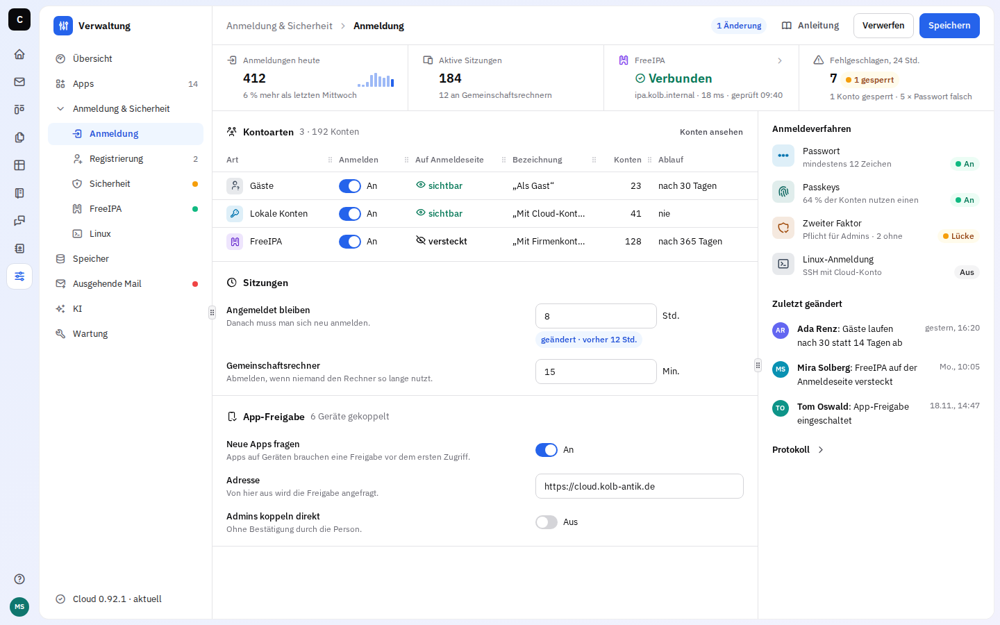

**Brief.** An admin checks how people sign in. 1: the state at a glance
(sign-ins, sessions, the directory, failures); 2: the kinds of account as
a table; 3: the settings and methods. Hero: the strip of key figures.
390: the figures two to a row, then the settings. 1024 and 1440: the
page beside a side column of methods and history. 1920: not built yet.

The state first as `Cells` (a `trend`, chips with tone); a `Table` for the
one setting with a value per kind (a switch per row); `Setting` rows for
everything else, one `Section` per topic; a `Pane side` with the methods
as rows with `mark` and state, and `Digest activity` of who changed what.
The head says "1 Änderung" and saves the page as a whole.

- States: `saved` (nothing to save: the deeds are disabled).

## table.tsx: a table with key figures

**Brief.** A bookkeeper on the morning round. 1: what is overdue and how
much; 2: which reminders go out today; 3: what is open in all. Hero: the
strip of key figures. 390: the strip, then two-line rows. 1024: the table
drops due date and person as room runs out. 1440: all columns. 1920: not
built yet (the overdue customers' last contact beside the table).

A `Nav` with the app's places and accounts; the key figures as one strip
of `Cells` above the table (open, overdue, reminders due, each with one
quiet line; the count stands once, in the current tab); `Table` with
widths, the invoice's `Mark` before its number (`Column mark`), the person
in charge as `Avatar`,
a status `Chip`, an amount column `align: "end"`, a quiet icon button with
its name only where the deed is due, `drop` on the columns that matter
least, and `phone(row)` so the phone shows two-line rows instead of a cut
table. `open(row)` gives each row the address of its invoice (on the phone
too); `empty` says "Keine offenen Rechnungen." in place of the table, and
`loading` would hold its place while the rows load.

- A failed load shows no figures: they are data too.
- On the phone the rows keep the mark, and a state that needs a person
  stays as a chip in `marks`.
- A deed per row is a `Button` in its own last column: `variant="text"`
  with words where the table has room, a `ghost` icon with its `label`
  where the widths must fit beside a sidebar at 1024 px.

## filtered-table.tsx: a table people filter, sort and group

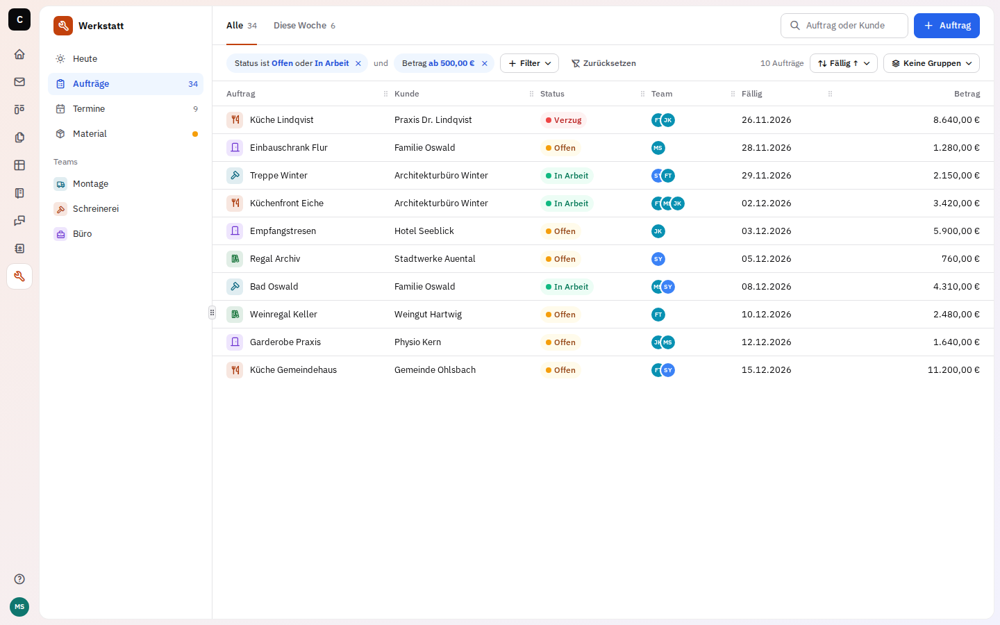

**Brief.** A workshop lead narrows the orders down. 1: which orders match
and how many; 2: the late ones; 3: team, due date and amount. Hero: the
filter row with its count. 390: one scrolling filter line, two-line rows.
1024 and 1440: one filter row above the full table. 1920: not built yet.

`defineListQuery` declares the fields (`choice`, `numberRange`, `lookup`),
the search, the sorts and the grouping once; `FilterBar` shows the active
filters as statements in `Pane status`, with the count and sum in
`results` and `ListOrder` (sort and grouping in words) at its `end`, so
the page head has two rows. The `Table` shows what the server found for
the address: each order with the mark of its kind (`Column mark`), the
team as `Avatar` or `Avatar.Stack`, the state as a chip.

- The server reads the same address with `orderQuery.parse(...)` and filters
  its own data; `@k2b/ui` filters nothing.
- The bar writes the address and calls `onChange`; load the rows again there.
- On the phone the bar is one line that scrolls; a tap opens the filter sheet.
- Pass `views` only when the app stores views (see
  [list queries](list-queries.md)).

## actions.tsx: where deeds stand

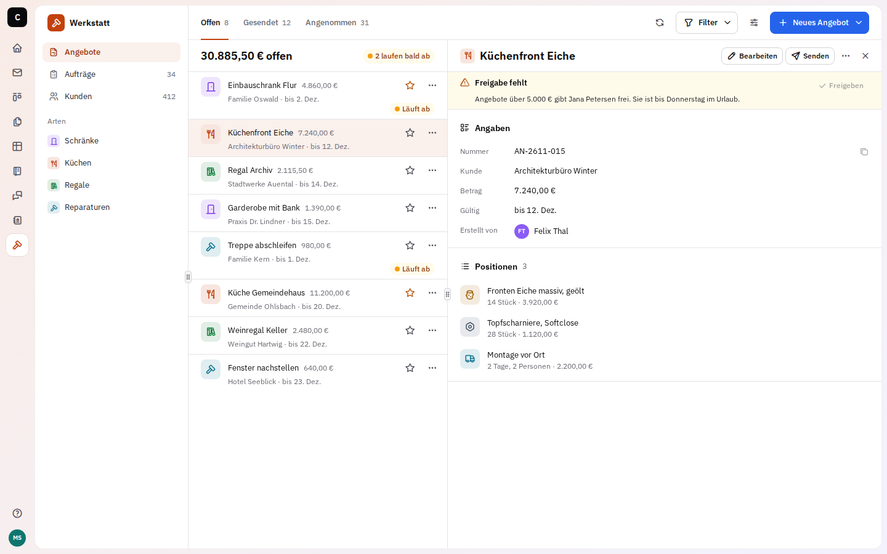

**Brief.** A salesperson works through offers. 1: the open offer and its
next deed; 2: offers about to expire; 3: the others. Hero: the open offer
with its deeds. 390: the list, an offer as its own page. 1024 and 1440:
the list beside the offer. 1920: not built yet.

The head `Bar` holds `Tabs`, a `Popover tip` on the refresh button, a
`Menu` "Filter" with ticked entries (a `Popover` in the head leaves on the
phone), a `Menu` with a choice section and toggles, and the one primary as
a `Menu` with a submenu. Each `Row` stands in a `Menu.Context`, leads with
the mark of its kind and has a `Button pressed` star and a "…" `Menu` with
the same entries in its `end`. The offer the address names opens in a
`Pane detail` with its own deeds; `Button busy` while it sends, and a
`Notice` with a `disabled` action that says why.

- One list of entries feeds the row's "…" and its right-click.
- Deleting answers with a toast and "Rückgängig".

## dialogs.tsx: a dialog, a question, a toast

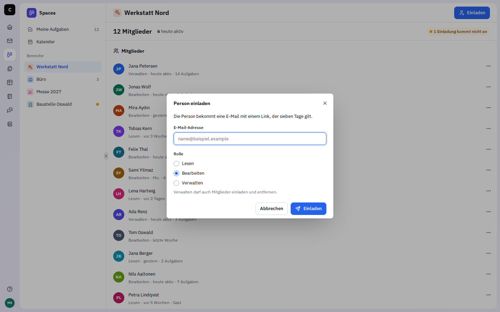
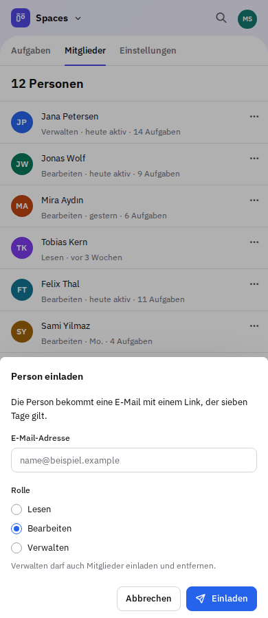

**Brief.** A space's admin looks after its members. 1: who is in and
with which role; 2: the invitation that does not arrive; 3: the open
invitations. Hero: the members; while it is open, the dialog. 390: rows
with their menu, the dialog a sheet. 1024 and 1440: the same rows across
the page. 1920: not built yet.

Members of a space (the spaces with their marks in the `Nav`, the open
one current; the space's views as `Tabs` in the head) as rows with
avatars, the role and the last activity in the second line and a "…"
menu at the end (on the phone too); open invitations as rows with the
initials of the address. "Einladen" opens a `Dialog` with `Field`s and
its own primary in the foot (a sheet on the phone);
`Workspace primary` opens the same dialog. Removing a member asks with
`Dialog.confirm`, then a toast offers "Rückgängig"; "Erneut senden"
answers with a toast with `status` `ok` or `bad`.

- A menu entry that opens `Dialog.confirm` returns nothing (`void`), so
  the menu closes while the question asks.
- The open state of the dialog lives in the screen (`open`,
  `onOpenChange`).

## states.tsx: the states of a list

**Brief.** Staff at the goods-in. 1: what arrived today; 2: the damaged
delivery; 3: a fault at a gate. Hero: the arrivals; in a state, its one
sentence. 390: two-line rows. 1024 and 1440: the full table. 1920: not
built yet.

A table of deliveries (supplier with the mark of its goods, gate,
amount, value, who checked it with an avatar, its state as a word and a
chip only where something is off, the time),
with a `StatusRow` and its states in the place of the rows:
`Empty` for nothing yet and another `Empty` for nothing behind a
filter, `Loading` with the rows and lines that usually come, `Failed`
with "Erneut versuchen". A `Notice tone="bad"` names the deed for a
problem a person must fix; a connection that retries on its own says so in
the `StatusRow` facts.

- The head and the status row never move between the states.

## content.tsx: a page to read

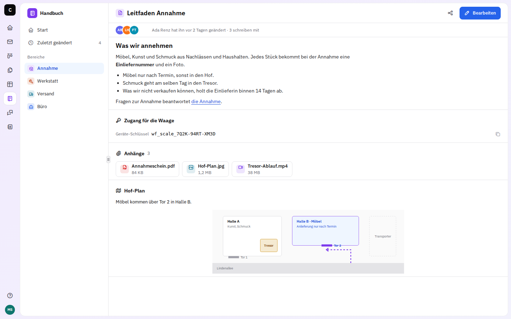

**Brief.** A worker reads a page of the handbook. 1: the text; 2: the
yard plan; 3: the files and the key for the scale. Hero: the text column.
390: one column. 1024 and 1440: the text beside its side column. 1920:
not built yet.

A `Nav` with the areas of the handbook and their marks; a head `Bar`
with the page's `Mark` and its title as `Text type="lead"` in `Inline`, a
ghost "Teilen" and the one primary "Bearbeiten" (mirrored as `Workspace
primary`); a status `Bar` with the writers as `Avatar.Stack` and who
changed it last; a `Band`
with the text as `Prose markdown` (rendered safely: no raw HTML, no images,
only web and mail links); a `Section` with a key in `Facts` (`mono`,
`copy`); the files as `Tiles` with the colour of their type in a
`Section` with a count; a plan of its own
in a `Canvas` with `height`, directly in its `Section`. `states` exports
empty (`Empty` with "Text schreiben"), loading (`Loading` rows) and failed
(`Failed`), each in place of the text below the head.

- Writing the text happens behind "Bearbeiten": the Markdown editor of
  `@k2b/editor` has no v2 form yet (gap).
- Code to read and copy is a `Facts` item with `mono` and `copy`; a code
  block with highlighting is a gap. Media open from their `Tiles`; an image
  or video viewer is a gap.
- A chart is a `Chart` of `@k2b/ui` in a `Canvas` in its `Section`, sized
  `style={{ height: "100%" }}`. Inside `.k2-ui` it takes the v2 font, the
  meta role (12 px), the v2 inks and lines, the surface as separator in
  both themes, the text edge in a `Canvas`, and a tooltip like a v2
  overlay. It needs the `@k2b/ui` stylesheet and a `.k2b-ui` ancestor, which
  every Cloud page has; with `v2.css` alone a chart has no size (gap), so
  this recipe draws its plan itself.
- With no data, put `Empty` in place of the `Canvas`. `Loading` and
  `Failed` hold rows, not the height of a drawing, so the page moves while a
  chart loads (gap).
