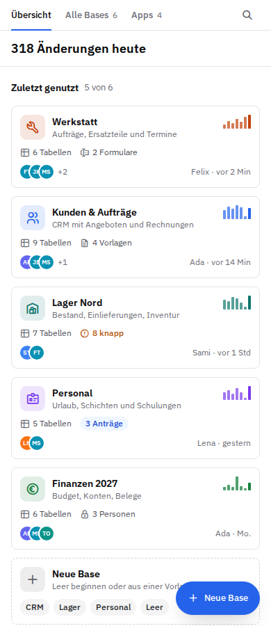
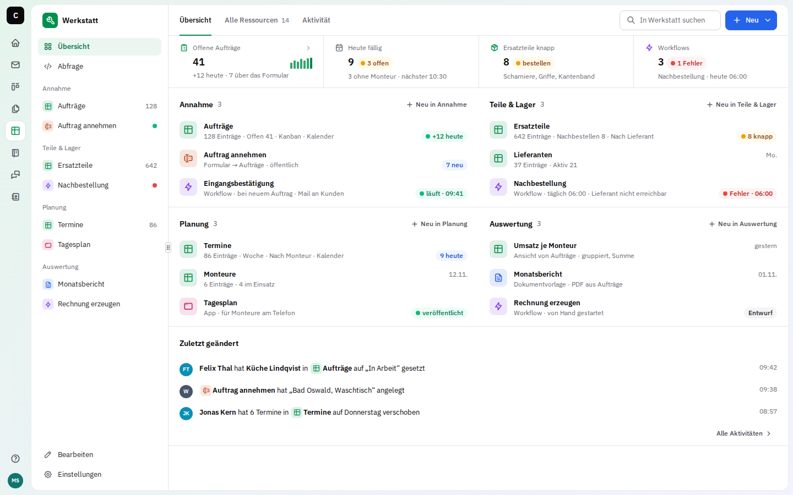
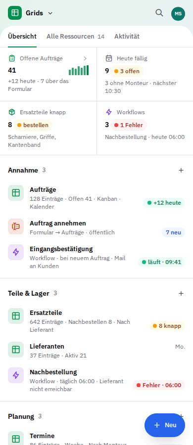

# Recipes

A recipe is a whole screen in one file under `recipes/`, with sample data at
the top and one default export. Copy the file, keep its structure, replace
the data. The pictures in `images/` are drawn from these files by
`packages/ui/scripts/v2-preview.ts` (light, 1440 and 390 px), and a browser
test keeps every recipe free of findings, so code and picture always match.

Read the recipe file next to its picture: each part in the code is one
thing you can point at in the image.

Most recipes also export `states`: the same screen empty, loading, failed
or in another state that fits it (a form while it saves). Fibel's examples
switch between them, and the browser test checks each one. A state stands
where the data would stand; the head and the status row never move. A
state that shows an open menu, panel, dialog or toast is `{ render, press }`:
the screen, and the names of the buttons and menu entries a person presses,
in order, to open it.

## The recipes and the look

A recipe stands here only when it meets [the look](look.md): its rows
lead with a mark, one column shows the shape of the data, people stand
beside what they did. For every other kind of screen there is no recipe
yet: build to the rules R1–R13 in [the look](look.md), with their
numbers. Never copy a bare screen from an app, an older picture or the
test screens in `test/v2-screens` of the package repository.

## overview.tsx: an overview of things with a face

The bases of Grids. `Nav` entries with `color`, so each base leads with its
`Mark`; a `StatusRow` whose lead says what counts today, with chips for
what lets a person act; `Tiles variant="card"` with `stats`, `people`,
`foot`, `trend` and the `create` card with templates as `choices`; a
`List` of two-line `Row`s with `mark` in the colour of their kind; a
`Pane side` with `Digest activity`, each sentence with the thing's
`Mark` and name.

- A base has one colour and symbol, the same in the sidebar, on its card
  and in a sentence. A kind of thing (table, board, form) has one colour
  across the app.
- A form or a workflow that did something is a person with its name.
- States: `empty` (a new installation; the card that makes a base stays).

## home.tsx: the home of one place

One base: `Cells` with a `trend` on the first, the things as `Section`s of
`Row`s with `mark`, their figures in the second line and their state as a
chip in `marks`; then `Digest activity` under "Zuletzt geändert".

- A state that needs a person (a failed workflow, new form entries) stands
  in its row and as a `dot` on its sidebar entry.
- States: `quiet` (a day without anything that needs a person).
